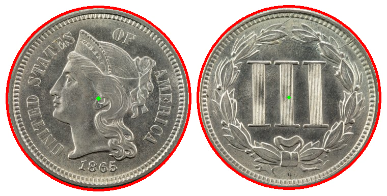

# 霍夫圆检测工具

一个带图形界面的霍夫圆检测小工具：导入图片、拖动参数、实时看红圈预览、导出标注图。仓库同时保留两张实拍图的验收参数与结果图，方便复现和评审。

## 功能

- 导入 JPG / JPEG / PNG 图片，按比例预览。
- 调节 `dp`、`minDist`、`param1`、`param2`、`minRadius`、`maxRadius` 六个参数并立即重新检测。
- 内置 `coins`、`cookie-plate` 两组验收预设；打开文件名含 `coin`、`cookie` 或 `plate` 的图片时自动套用。
- 一键导出原图分辨率的标注图。
- 无界面模式，便于一条命令复现验收结果、生成 README 图片。
- 视频导入与逐帧检测：目前只有需求与规划，代码尚未实现，见 `openspec/changes/add-video-input/` 与 Issue #1。

## 环境

- Ubuntu 24.04（WSL 2 可用）
- Python 3.10+
- Tkinter（Ubuntu 上由系统包提供）

```bash
sudo apt install python3-tk
python3 -m venv .venv
source .venv/bin/activate
pip install -r requirements.txt
```

依赖：`opencv-python-headless`、`numpy`、`Pillow`。使用 headless 版 OpenCV 是因为界面由 Tkinter 负责，不依赖 OpenCV 自带的窗口系统。

本次交接在 Python 3.12.3、OpenCV 4.14.0、NumPy 2.5.5、Pillow 11.3.0 下复验通过，版本均满足 `requirements.txt` 的范围；首轮验收记录使用 OpenCV 4.6.0，两次的检出数量与半径一致。

## 样例获取

`examples/coins.jpg` 与 `examples/cookie-plate.jpg` 已随仓库提供，无需另外下载。两张图来自 Wikimedia Commons 的实拍素材，已缩放并重新编码；作者、原始链接与许可见 [examples/SOURCES.md](examples/SOURCES.md)。视频模式需要的样例视频尚未入库，规划中的生成与登记方式见 `openspec/changes/add-video-input/design.md`。

## 启动

```bash
python3 app.py
```

操作顺序：

1. 点 **打开图片**，选择 `examples/coins.jpg` 或 `examples/cookie-plate.jpg`。
2. 确认 **预设** 自动切到对应值；也可以手动拖动滑块调参。
3. 状态栏显示当前圆数量和参数，画布实时更新红圈。
4. 点 **导出标注图**，选择保存路径，得到与原图同尺寸的标注图。

## 两张图的验收参数

| 图片 | 预设 | dp | minDist | param1 | param2 | minRadius | maxRadius | 期望 |
| --- | --- | --- | --- | --- | --- | --- | --- | --- |
| `examples/coins.jpg` | `coins` | 1.2 | 120 | 120 | 100 | 150 | 220 | 2 个硬币外缘圆 |
| `examples/cookie-plate.jpg` | `cookie-plate` | 1.2 | 150 | 120 | 50 | 210 | 270 | 1 个盘沿圆 |

参数与 `hough.PRESETS` 保持一致，测试直接引用同一份预设，避免文档和代码漂移。

## 验收结果

硬币图：两枚硬币的外缘各检测到一个圆，半径约 179 / 180 像素。



饼干盘图：只检测到盘沿一个圆，盘内饼干未被误判，半径约 243 像素。


### 无界面复现

```bash
python3 app.py --headless --image examples/coins.jpg --preset coins --output /tmp/coins-annotated.png
python3 app.py --headless --image examples/cookie-plate.jpg --preset cookie-plate --output /tmp/cookie-plate-annotated.png
```

预期输出：

```
Detected 2 circle(s): [(567, 191, 179), (193, 193, 180)]
Detected 1 circle(s): [(265, 257, 243)]
```

坐标顺序可能随 OpenCV 版本略有不同，数量和半径区间应保持一致。

## 测试

```bash
python3 -m unittest discover -s tests -v
```

- `tests/test_hough.py`：两张图的检测数量、半径区间、圆心位置，以及标注不修改原图。
- `tests/test_gui.py`：在真实 Tk 窗口中加载硬币图，断言圆数量、状态栏和画布内容；无 `DISPLAY` 时自动跳过。

## OpenSpec 记录

变更记录在 `openspec/changes/add-hough-circle-tool/`：`proposal.md` 说明动机与能力边界，`specs/hough-circle-detection/spec.md` 是可验证的行为规格，`design.md` 记录技术取舍，`tasks.md` 保留带验证方式的任务进度，`acceptance.md` 保存本次验收的命令、输出与判定。评审通过后再归档并把规格合并进 `openspec/specs/`。

下一项需求记录在 `openspec/changes/add-video-input/`：`proposal.md` 与 `specs/video-circle-detection/spec.md` 定义视频逐帧检测的行为，`design.md` 记录复用检测核心、CSV 字段和临时文件写法等取舍，`tasks.md` 列出实现任务与验收命令，并附交接状态。

```bash
openspec status --change add-video-input
openspec validate add-video-input --strict
openspec validate --specs
```

## 交接状态

- 当前完成：图片导入、六个参数调节、实时预览、导出标注图、无界面验收模式均已实现；两张图的预设、README 参数表、`hough.PRESETS` 与测试共用同一来源。OpenSpec 变更 `add-hough-circle-tool` 的 10 项任务全部完成，等待评审后归档。
- 已复验：自动测试 4 项通过，包含真实 Tk 窗口冒烟（本机 `DISPLAY=:0`，未被跳过）；无界面命令的输出与本文档一致；复验环境见“环境”一节。
- 未验证事项：归档与 `openspec/specs/` 合并尚未执行；`docs/` 两张标注图仍由首轮 OpenCV 4.6.0 生成，未用新版本重生成；其他分辨率、光照和素材的检测稳定性未测；单张图片检测耗时未测；视频模式完全未实现。
- 后续待办入口：从 `openspec/changes/add-video-input/tasks.md` 的任务 1.1 开始，对应 GitHub Issue #1；实现期间必须保持本文档“无界面复现”与“测试”两节命令通过。
- 分支与提交：工作分支按 `feat/<Issue编号>-<英文短语>` 或 `fix/<Issue编号>-<英文短语>` 命名（本交接分支为 `feat/1-video-input-handover`），提交信息用 `<type>: <short description>`。
- 目录导览：`hough.py` 检测核心，`app.py` 界面与无界面入口，`tests/` 自动测试，`docs/` README 标注图，`examples/` 样例与许可，`openspec/` 变更记录。

## 图片许可

两张实拍图来自 Wikimedia Commons，来源与署名见 [examples/SOURCES.md](examples/SOURCES.md)。
